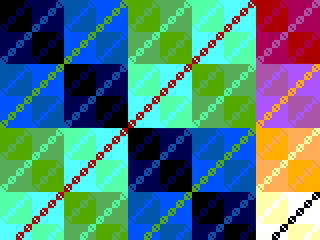

# BITFIELD — MathHacks 2026.

A 1x2 Tiny Tapeout chip that renders live mathematical art on a VGA
screen. There is no framebuffer and no stored artwork: every pixel is
evaluated in real time by a bitwise/sinusoidal function of `(x, y, t)`.
A 16-bit LFSR acts as a virtual VJ — about once per second it re-rolls the
pattern, palette and speed, so the show never stands still.



- 640x480 @ 60 Hz VGA generated directly from the 25.175 MHz tile clock.
- **7 patterns**, computed live from the pixel coordinates: XOR lattice,
  moiré rings, hyperbola field, ring interference, Sierpinski sieve,
  diagonal weave and tartan — the same equations as the BITFIELD website
  pattern demo.
- **4 colour maps**: direct, high bits, split, inverted.
- **Gallery mode**: cycles through the patterns every second, each with
  the website's default shift amount and colour map; the 8-bit time
  phase advances every frame so the picture is always moving.
- Manual mode: set `ui[4]=1` and pick the pattern with `ui[7:5]`, the
  colour map with `ui[3:2]`, the shift amount with `ui[1:0]`.
- No frame buffer, no BRAM, no sine LUT: squarers, a small multiplier,
  XORs and adders (about two thousand gates).
- Runs in the browser without any setup: once this repo is on GitHub, open
  `https://vga-playground.com/?repo=<repo url>` — the playground loads
  `info.yaml` and simulates `src/` directly (standard Tiny VGA PMOD pinout).

## How it works

The VGA timing generator sweeps `(x,y)` over the frame. Each pattern is a
small equation on those coordinates: `((x>>s) ^ (y>>s)) + t` nests XOR
squares, `(d2 >> (s+4)) + t` draws moiré rings from the squared distance
to the screen centre, `((x>>s) & ((y+t)>>s)) == 0` draws the Sierpinski
triangle. An 8-bit time phase `t` advances every frame, cycling the
colours and sliding the fringes. Every 60 frames the gallery counter
advances and the chip switches to the next pattern with its default
shift amount and colour map, so the show essentially plays itself. The
chosen 8-bit pixel value is reduced to 2 bits per colour channel through
one of four colour maps and blanked outside the active area.

## Simulating and testing

The cocotb test suite checks VGA line/frame timing, forced blanking,
manual/auto pattern selection and that the picture is alive and changes:

```sh
cd test
pip install -r requirements.txt
make
```

(With the OSS CAD Suite's bundled Icarus 14, `vvp` can segfault while
shutting down *after* cocotb has finished and written `results.xml`; use
`make -i` there. Distro Icarus 12, which CI uses, exits cleanly.)

To render real frames from the RTL into PPM images (needs `iverilog`):

```sh
iverilog -g2005 -o tb_render src/project.v test/tb_render.v
./tb_render   # writes frame_4.ppm ... frame_32.ppm
```

Run it from an empty directory: it writes eight 640x480 PPM files of
frames 4..32.

The `website/` folder contains an independent browser simulator that
builds `src/project.v` (the same file used for tapeout, there is no copy)
with Verilator compiled to WebAssembly and decodes the VGA output pins
directly — run `npm install && npm run dev` inside `website/`.

## Seeing the chip

Every push runs the Tiny Tapeout GDS action (LibreLane) which hardens the
design and renders the layout. The action's `viewer` job publishes the GDS
and the render to GitHub Pages, and the website's Physical Layout section shows the rendered
layout once it is published.

Visit omrawaley.github.io/bitfield/ to see the chip's GDS render.

## Datasheet

See [docs/info.md](docs/info.md) for the full description, pinout and the
external hardware you need (TinyVGA PMOD + any 25.175 MHz clock).

## About Tiny Tapeout

Tiny Tapeout makes it cheap to get digital designs manufactured on a real
chip: <https://tinytapeout.com>. This repository is based on the
[ttsky-verilog-template](https://github.com/TinyTapeout/ttsky-verilog-template);
the GitHub action builds the GDS using LibreLane.
