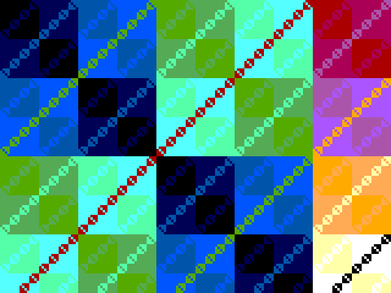
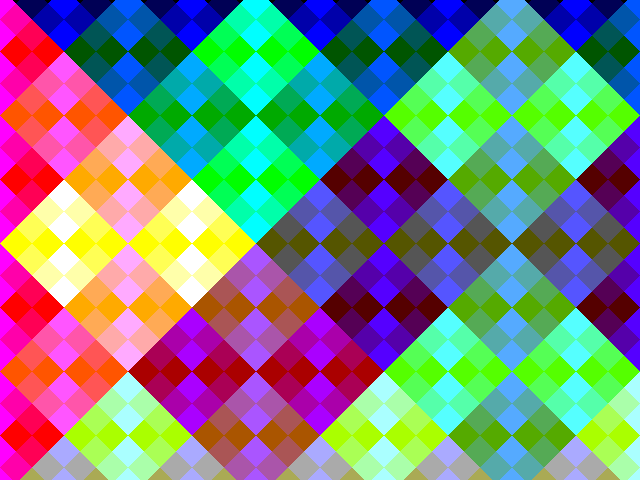

<!---

This file is used to generate your project datasheet. Please fill in the information below and delete any unused
sections.

You can also include images in this folder and reference them in the markdown. Each image must be less than
512 kb in size, and the combined size of all images must be less than 1 MB.
-->

## How it works

This 1x2-tile design renders live digital art on a VGA screen (640x480 at
60 Hz, pixel clock = the tile clock). Every pixel shown is computed in
real time from its coordinates — no stored artwork:

* **7 pattern equations**, evaluated per pixel — the same gallery as the
  BITFIELD website pattern demo: XOR lattice `((x>>s) ^ (y>>s)) + t`,
  moiré rings `(d2 >> (s+4)) + t` with `d2 = (x-320)² + (y-240)²`,
  hyperbola field `((x·y) >> (s+6)) + t`, ring interference
  `((d2>>8) + t) ^ ((x^y) >> s)`, Sierpinski sieve
  `((x>>s) & ((y+t)>>s)) == 0`, diagonal weave
  `((x+y+t)>>s) ^ ((x-y-t)>>s)`, and tartan
  `(((x>>s)|(y>>s)) ^ ((x>>(s+2)) & (y>>(s+2)))) + t`.
* **Gallery mode**: every 60 frames (~1 s) the chip switches to the next
  pattern with the website's default shift amount and colour map, and the
  8-bit time phase `t` advances once per frame, so the picture is always
  moving.
* **4 colour maps** (direct, high bits, split, inverted) map the 8-bit
  pixel value onto the 2-bits-per-channel VGA output.
* **Manual override**: with `ui[4]=1` the DIP switches select the pattern
  (`ui[7:5]`), colour map (`ui[3:2]`) and shift amount (`ui[1:0]`).

*Selected frames, captured from RTL simulation of this exact design.*

## How to test

1. Clock the design at **25.175 MHz** (standard VGA pixel clock). On the
   Tiny Tapeout demo board, use the clock setting/embedded clock chip
   configuration for an external clock, or feed any 25-26 MHz source.
2. Wire a VGA monitor using the Tiny VGA PMOD on the output pins (this is
   also exactly what the Tiny Tapeout web VGA playground decodes):
   R1 = uo[0], G1 = uo[1], B1 = uo[2], VSYNC = uo[3], R0 = uo[4],
   G0 = uo[5], B0 = uo[6], HSYNC = uo[7] (syncs active low).
3. Power up. Within a second the monitor shows the auto-VJ show: a new
   mathematical pattern roughly every second, colours swapping, time
   morphing the picture.
4. Flip the DIP switches (manual mode, `ui[4]=1`) to take over:
   * `ui[7:5]` — pattern index 0..6 (lattice, rings, hyperbola,
     interference, Sierpinski, weave, tartan).
   * `ui[3:2]` — colour map: direct, high bits, split, inverted.
   * `ui[1:0]` — shift amount (0..3) for the bitwise patterns.

## Gallery

*Auto mode: XOR lattice — nested squares, one per power-of-two bit
period, with the slow time phase cycling the colours.*

*Diagonal weave: two shifted stripe families crossed, coloured through
the split colour map.*

## External hardware

* TinyVGA PMOD (or any VGA monitor wired to the uo pins with a small
  75-ohm DAC — 2-bit VGA ladder resistors work as usual).
* Optional: a 25.175 MHz clock source or the available TT demo board
  clock configuration for it.
